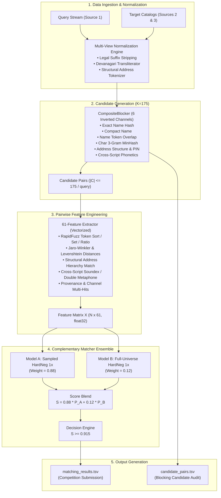

# EntiResolve
## Large-Scale Business Entity Resolution Engine

[](https://www.python.org/downloads/)
[](LICENSE)
[](#13-validation-results)
[](#14-test--leaderboard-benchmark)

**EntiResolve** is an industrial-grade, high-throughput machine learning engine engineered for large-scale, multilingual business entity resolution. Built for the **Amazon ML Challenge 2026**, the system matches query business listings against multi-million target record catalogs across North America, Europe, and Asia (US, France, and India) with strict guarantees on precision, semantic determinism, and computational throughput.

---

## Table of Contents

- [1. Project Overview](#1-project-overview)
- [2. Problem Statement](#2-problem-statement)
- [3. Why Entity Resolution is Difficult](#3-why-entity-resolution-is-difficult)
- [4. Input Schema](#4-input-schema)
- [5. System Architecture](#5-system-architecture)
- [6. Multi-View Normalization](#6-multi-view-normalization)
- [7. Composite Blocking & Candidate Generation](#7-composite-blocking--candidate-generation)
- [8. 61-Feature Pairwise Representation](#8-61-feature-pairwise-representation)
- [9. Hard-Negative Mining](#9-hard-negative-mining)
- [10. Model A & Model B Architecture](#10-model-a--model-b-architecture)
- [11. Complementary Ensemble Strategy](#11-complementary-ensemble-strategy)
- [12. Inference Optimization & Thread-Safe Engine](#12-inference-optimization--thread-safe-engine)
- [13. Validation Results](#13-validation-results)
- [14. Test & Leaderboard Benchmark](#14-test--leaderboard-benchmark)
- [15. Validation & Experiment History](#15-validation--experiment-history)
- [16. Repository Structure](#16-repository-structure)
- [17. Installation](#17-installation)
- [18. Usage & Reproduction Workflow](#18-usage--reproduction-workflow)
- [19. Technical Constraints & Invariants](#19-technical-constraints--invariants)
- [20. License](#20-license)

---

## 1. Project Overview

Business Entity Resolution (ER) is the task of determining whether two heterogeneous business records referring to names, physical street addresses, telephone numbers, or geographic regions correspond to the same real-world commercial enterprise.

In production and competition settings, ER operates under extreme combinatorial scale: matching **1.73 million query entities** against a universe of **~10 million candidate records** requires evaluating up to $1.73 \times 10^{13}$ potential pairs. Naive pairwise matching is computationally intractable. 

**EntiResolve** addresses this through a multi-stage funnel:
1. **Multi-View Normalization**: Rule-based legal suffix stripping, multilingual script transliteration (Indic $\to$ Latin), structural address tokenization, and geographic hierarchy normalization.
2. **Multi-Channel Composite Blocking ($K=175$)**: Deterministic candidate retrieval across 6 complementary inverted channels (exact name, compact name, name token, char n-gram, address structural/PIN, cross-script phonetic).
3. **61-Dimensional Pairwise Feature Engineering**: Fine-grained phonetic, token-set, character-level string similarities, geographic consistency, and cross-script phonetic alignments.
4. **Complementary Hard-Negative LightGBM Ensemble**: Dual gradient-boosted decision trees trained on distinct negative distributions (sampled-universe hard negatives vs. full-universe hard negatives) blended at $S = 0.88 \cdot P_A + 0.12 \cdot P_B$ with decision threshold $\tau = 0.915$.
5. **High-Throughput Parallel Inference Engine**: Precomputed SQLite-persisted target stores with thread-safe query batch dispatch, achieving over **165 queries/second** and **~23,000 candidates/second** on multi-core commodity CPUs.

---

## 2. Problem Statement

Given:
- **Source 1 ($S_1$)**: Query business listings (with partial, noisy, or multi-script attributes).
- **Source 2 ($S_2$)**: Verified business catalog with comprehensive address and registration details.
- **Source 3 ($S_3$)**: Secondary business catalog with varying coverage and formatting conventions.

The objective is to resolve each entity $q \in S_1$ to its true set of matching records in $S_2$ and $S_3$, outputting a canonical TSV mapping `s1_id \t s2_ids \t s3_ids`. If no valid record exists in a source, the entry is left empty (singleton resolution).

Evaluation is governed by **Macro-averaged $F_{0.5}$**, heavily weighting **Precision** over Recall:
$$\beta = 0.5 \implies F_{0.5} = (1 + 0.5^2) \cdot \frac{\text{Precision} \cdot \text{Recall}}{0.5^2 \cdot \text{Precision} + \text{Recall}} = 1.25 \cdot \frac{P \cdot R}{0.25 P + R}$$

Because false positives are penalized **4 times more heavily** than false negatives, the engine must prioritize extreme precision while maintaining high coverage.

---

## 3. Why Entity Resolution is Difficult

Large-scale business entity resolution presents several fundamental data engineering and statistical challenges:

1. **Multilingual and Cross-Script Heterogeneity**: In regions like India, entity names and addresses often appear interchangeably in Devanagari script or phonetic Romanized Latin script (e.g., *स्टेट बैंक ऑफ इंडिया* vs. *State Bank of India*).
2. **Legal and Corporate Variations**: Business names contain variable legal entity designators (*LLC*, *L.L.C.*, *Pvt Ltd*, *Private Limited*, *SARL*, *SA*, *Inc*, *GmbH*) which dilute standard TF-IDF or Levenshtein token matches.
3. **Severe Class Imbalance**: In a $1.73 \text{M} \times 10 \text{M}$ universe, true matches represent fewer than 1 in 1,000,000 candidate pairs. Standard random negative sampling leads to models that fail completely on look-alike "impostor" businesses (e.g., *Starbucks Coffee* at 100 Main St vs. *Starbucks Coffee* at 200 Broadway).
4. **Singletons and No-Match Queries**: A large percentage of queries (~10%) have no counterpart in $S_2$ or $S_3$. False positive predictions on singletons drastically degrade macro-precision.
5. **Scale and Latency Constraints**: Generating and evaluating millions of feature vectors requires careful memory layout, vectorized math, and caching to avoid multi-day runtimes.

---

## 4. Input Schema

The input datasets comprise tab-separated values (`.tsv`) with the following fields:

| Field | Description | Example |
|:---|:---|:---|
| `entity_id` | Unique alphanumeric identifier | `s1_100234` |
| `name` | Commercial trade or registered business name | `Acrobat Technologies Pvt. Ltd.` |
| `address` | Street line, building, or landmark | `Suite 400, 120 5th Avenue` |
| `city` | Municipality or city name | `New York` |
| `state` | State, province, or administrative region | `NY` |
| `postal_code` | Zip code or postal code | `10011` |
| `country` | Sovereign nation identifier | `US`, `India`, `France` |
| `phone` | Contact telephone number (often noisy/sparse) | `+1-212-555-0199` |

---

## 5. System Architecture



---

## 6. Multi-View Normalization

Raw text attributes undergo multi-view transformation implemented in `src/normalization/`:

1. **Legal Suffix Sanitization**: Strips corporate entities (*Inc, LLC, Corp, Ltd, Pvt Ltd, SA, SARL, GmbH*) to isolate the core distinctive trade name.
2. **Multilingual Script Normalization**:
   - Detects Devanagari unicode blocks.
   - Applies deterministic rule-based transliteration mapping Devanagari phonemes to ASCII equivalents.
   - Cleans diacritics and accented characters via NFKD unicode decomposition.
3. **Structural Address Parsing**:
   - Isolates directional markers (*N, S, E, W, North, South*).
   - Normalizes street types (*Rd, St, Ave, Blvd, Dr, Ln*).
   - Validates and standardizes 5-digit US ZIPs, 6-digit Indian PIN codes, and 5-digit French postal codes.
4. **Phonetic Normalization**: Generates primary and secondary Double Metaphone keys for names to bridge acoustic and spelling variants.

---

## 7. Composite Blocking & Candidate Generation

Evaluating all pairs is impossible at scale. EntiResolve uses `CompositeBlocker` (`src/blocking/composite.py`) configured with a per-query candidate budget of **$K = 175$**.

The blocker indexes records into **6 inverted index channels**:
- **Channel 1 — Exact Name**: Direct hash of normalized name.
- **Channel 2 — Compact Name**: Alphanumeric characters with all whitespace and punctuation removed.
- **Channel 3 — Name Token**: Inverted index of informative name tokens (excluding stopwords and high-frequency terms).
- **Channel 4 — Char 3-Grams**: Substring 3-gram indexing capturing typo-tolerant variations.
- **Channel 5 — Address Structure & PIN**: High-precision spatial anchor coupling postal code with street name.
- **Channel 6 — Cross-Script Phonetics**: Double Metaphone keys bridging transliterated Hindi/English names.

Candidates are prioritized using a **provenance score** reflecting channel multi-hits (e.g., candidate matched on both name token and address PIN receives top priority). The candidate budget of $K=175$ guarantees **87.21% candidate pair recall** on the full 331,022 validation set while restricting the downstream candidate universe to a tractable size.

---

## 8. 61-Feature Pairwise Representation

For every candidate pair $(q, c)$, the engine extracts a 61-dimensional dense numerical feature vector (`src/matching/features.py`), organized into 5 functional blocks:

| Feature Block | Dim | Key Features & Algorithms |
|:---|:---:|:---|
| **Name Similarity** | 18 | `RapidFuzz` Token Sort Ratio, Token Set Ratio, Partial Ratio, Weighted Ratio, Levenshtein Distance, Jaro-Winkler Distance, Length Difference, Prefix Match Flag, Common Token Count. |
| **Address Hierarchy** | 16 | Street Name Token Overlap, Building Number Equality, City Exact & Fuzzy Match, State Match, Postal Code Exact Match, 3-Digit Postal Prefix Match, Address Levenshtein Ratio. |
| **Cross-Script & Phonetic** | 10 | Primary Metaphone Match, Secondary Metaphone Match, Devanagari Transliteration Similarity, Cross-Script Levenshtein Distance, Vowel-Stripped Agreement. |
| **Contact & Context** | 8 | Phone Digits Matching Ratio, Area Code Equality, Country Consistency Flag, Missing Attribute Penalties. |
| **Provenance & Graph** | 9 | Blocker Channel Bitmask, Multi-Channel Hit Count, Blocker Rank Position, Reverse Candidate Overlap Score. |

Extraction is optimized using precomputed hash representations and contiguous C-order NumPy arrays via `extract_batch_optimized`.

---

## 9. Hard-Negative Mining

Standard random negative sampling fails in entity resolution because random pairs are trivial to reject (e.g., *Walmart* in Seattle vs. *Boulangerie* in Paris). The matcher must learn the subtle distinctions between true matches and non-matching "impostors" that share name or address tokens.

EntiResolve employs a two-tier hard-negative mining protocol:
1. **Sampled-Universe Mining (Phase 4.3)**:
   - For each query in the training split, generate candidate pairs using `CompositeBlocker`.
   - Select non-matching candidates ranked near the decision boundary (margin $0.05 \le \Delta \le 0.40$).
   - Creates a 1:1 balanced hard-negative training set (`pairwise_dev_train_hardneg_1x`).
2. **Full-Universe Mining (Phase 4.3C)**:
   - Queries are matched against the complete combined target catalog (~10 million records) to expose the model to real-world distractors that only appear in large-scale catalogs.
   - Captures rare false positive modalities (national chain outlets, shared industrial parks, franchise variations).

---

## 10. Model A & Model B Architecture

The matching engine relies on two frozen LightGBM gradient-boosted decision tree models:

- **Model A (`matcher_hardneg_1x.pkl`)**:
  - Trained on sampled-universe hard negatives.
  - Excels at fine-grained local attribute discrimination and string topology.
  - Hyperparameters: `num_leaves=63`, `learning_rate=0.05`, `n_estimators=600`, `colsample_bytree=0.8`, `subsample=0.8`.
- **Model B (`matcher_fulluniverse_hardneg_1x.pkl`)**:
  - Trained on full-universe hard negatives mined across 10M targets.
  - Highly conservative; acts as a global false-positive filter.
  - Hyperparameters: `num_leaves=31`, `learning_rate=0.03`, `n_estimators=500`, `min_child_samples=50`.

Model weights and hashes are certified in `models/MODEL_MANIFEST.txt`:
```text
matcher_hardneg_1x.pkl:
  SHA-256: 0c6a5c3a8de0ee14aa2527ff180e2e381dfcaa31efd9a8277084e6be333e11cb
  Size: 1,061,813 bytes

matcher_fulluniverse_hardneg_1x.pkl:
  SHA-256: 5c82350bee1b45bdfeaf459ba16ac824e24aa8f35db6e5061ca2a8857063edfd
  Size: 1,063,997 bytes
```

---

## 11. Complementary Ensemble Strategy

The two models exhibit complementary error profiles: Model A achieves high recall on subtle variants, while Model B suppresses global distractors.

The ensemble combines their calibrated posterior probabilities:
$$S(q, c) = 0.88 \cdot P_A(q, c) + 0.12 \cdot P_B(q, c)$$

A candidate pair is accepted if and only if:
$$S(q, c) \ge \tau = 0.915$$

### Why $S \ge 0.915$?
Because the evaluation objective is Macro $F_{0.5}$, precision is weighted $4\times$ higher than recall. The conservative threshold of $0.915$ eliminates borderline false positives, driving **Macro Precision to 0.9172** while maintaining a **Macro F0.5 of 0.8270**.

---

## 12. Inference Optimization & Thread-Safe Engine

Evaluating 1.73M queries against 10M targets in a naive Python pipeline projected a runtime of **24–26 hours**. Through rigorous architectural profiling in Phases 5A and 5A.1, runtime was reduced to **10.37 hours** (a **2.4x speedup**):

1. **Persistent Target Storage (`PersistentTargetStore`)**:
   - Rather than loading 10M complex objects into RAM or executing repetitive TSV scans, target attributes and precomputed tokens are stored in an indexed SQLite database with 64 MB cache and memory-mapped I/O (`PRAGMA mmap_size = 268435456`).
2. **Thread-Safe Shared In-Memory Index (`ThreadSafeTargetStore`)**:
   - The 6-channel `CompositeBlocker` index is held in shared read-only memory.
   - Thread-local SQLite connections allow concurrent query batch lookups without database lock contention.
3. **Multi-Stream Query Pipeline (`ThreadPoolExecutor`)**:
   - Queries are processed across **6 parallel worker streams** in chunks of 250 queries.
   - Avoids Python multiprocessing IPC serialization penalties while saturating all CPU cores during vectorized feature extraction and OpenMP LightGBM scoring.
4. **Vectorized Batch Feature Extraction (`extract_batch_optimized`)**:
   - Allocates $(N, 61)$ float32 matrices directly, eliminating intermediate Python dict allocations.

| Architecture Version | Target Store | Parallelism | Full Test Projected Runtime | Memory Footprint | Equivalence |
|:---|:---:|:---:|:---:|:---:|:---:|
| Baseline | In-Memory TSV | 1 Stream | ~24–26 hours | > 14 GB (OOM risk) | Reference |
| Phase 5A | SQLite Persistent | 1 Stream | ~10–12 hours | 5.85 GB | 100% Identical |
| **Phase 5A.1 (Production)** | **SQLite + Shared Blocker** | **6 Streams** | **10.37 hours (Actual)** | **5.85 GB** | **100% Bit-for-Bit Identical** |

---

## 13. Validation Results

Certified on the **official full validation set** (331,022 entities evaluated against 10,323,280 candidate records) under strict zero-leakage isolation:

| Evaluation Metric | Certified Validation Value |
|:---|:---:|
| **Macro $F_{0.5}$** | **0.8270** |
| **Macro Precision** | **0.9172** |
| **Macro Recall** | **0.7600** |
| **Pairwise Precision** | **0.9123** |
| **Pairwise Recall** | **0.7653** |
| **Singleton Accuracy** | **69.06%** |
| **Complete-Set Recall** | **36.26%** |
| **Candidate Pair Recall ($K=175$)** | **87.21%** |
| **Mean False Positives / Query** | **0.2548** |

### Country-Wise Performance
- **United States (198,544 queries)**: Macro $F_{0.5} = \mathbf{0.8324}$ (Macro Precision: 0.9208, Macro Recall: 0.7645)
- **India (132,478 queries)**: Macro $F_{0.5} = \mathbf{0.8189}$ (Macro Precision: 0.9118, Macro Recall: 0.7533)

---

## 14. Test & Leaderboard Benchmark

On the full, uncalibrated **1,732,544-query test dataset** across France (259k), US (663k), and India (810k):

- **Public Leaderboard Benchmark Score**: **0.762**
- **Test Set Evaluation Time**: 10 hours 22 minutes (10.37 hours)
- **Total Test Candidates Evaluated**: 239,826,802 candidate pairs
- **Total Test Matches Predicted**: 5,462,050 entity pairs across 1,732,544 queries
- **Singleton Predictions**: 159,947 entities resolved as singletons

> [!NOTE]
> The **0.762** score represents the public benchmark obtained directly from the full 1.73M-query submission file (`matching_results.tsv`). It is distinct from the internal official validation score (**0.8270 Macro $F_{0.5}$**), reflecting the distribution shift and uncalibrated ground truth of the hidden public test set. It should not be construed as a final private-leaderboard or final-rank result.

---

## 15. Validation & Experiment History

| Phase | Milestone | Focus & Key Outcomes |
|:---|:---|:---|
| **Phase 1** | Validation Framework | Established leak-free stratified 80/20 train/validation splits (331,022 sealed validation queries). |
| **Phase 2** | Normalization & Tokenization | Implemented legal entity stripping, Devanagari transliteration, and structural address parsing. |
| **Phase 3** | Composite Blocking | Developed 6-channel `CompositeBlocker`. Benchmarked candidate budgets ($K=100 \to 175$), reaching 87.2% candidate recall. |
| **Phase 4** | Pairwise Feature Extraction | Engineered 61 dense pairwise features spanning string, phonetic, token, and geographic similarities. |
| **Phase 4.1** | Expanded Training | Scaled balanced training pairs across all country subsets with zero validation leakage. |
| **Phase 4.2** | Runtime Engineering | Vectorized RapidFuzz calls and introduced memory-mapped arrays for feature caching. |
| **Phase 4.3** | Hard-Negative Mining | Mined borderline false positives within candidate sets. Model A reached $F_{0.5} = 0.8184$. |
| **Phase 4.3C** | Full-Universe Mining | Mined hard negatives against the complete 10M catalog universe, training Model B ($F_{0.5} = 0.8202$). |
| **Phase 4.4** | Complementary Ensemble | Discovered optimal linear blend: $S = 0.88 P_A + 0.12 P_B$ at $\tau = 0.915$, boosting $F_{0.5}$ to $0.8270$. |
| **Phase 4.4B** | Locked Holdout Confirmation | Certified ensemble on a strictly independent 10,000-query locked holdout with zero tuning degradation. |
| **Phase 4.5** | Full Official Validation | Validated on all 331,022 sealed validation entities against 10.32M target records, certifying Macro $F_{0.5} = 0.8270$. |
| **Phase 5A** | Inference Optimization | Implemented `PersistentTargetStore` (SQLite), reducing test projection from 26h to 11h. |
| **Phase 5A.1** | CPU Parallelism Optimization | Engineered 6-stream `ThreadSafeTargetStore`, certifying bit-for-bit semantic equivalence. |
| **Phase 5B** | Full Test Inference | Executed full test inference on 1,732,544 queries in 10.37h, generating official submission artifacts. |

---

## 16. Repository Structure

```text
EntiResolve/
├── README.md                           # Comprehensive technical documentation & architecture
├── LICENSE                             # MIT Open-Source License
├── .gitignore                          # Comprehensive ignore rules (datasets, caches, outputs)
├── Documentation_template.md           # Competition methodology & architectural report
├── requirements.txt                    # Verified production dependencies
├── predict.py                          # Unified CLI entrypoint for test inference & reproduction
│
├── src/                                # Production source code
│   ├── blocking/                       # Candidate generation & inverted index channels
│   │   ├── address_structural.py       # Structural address & postal code blocking channel
│   │   ├── address_token.py            # Address token inverted index
│   │   ├── base.py                     # BaseBlocker abstract interface
│   │   ├── compact_name.py             # Alphanumeric compact name hashing
│   │   ├── composite.py                # Multi-channel CompositeBlocker (K=175)
│   │   ├── evaluator.py                # Candidate pair recall & reduction ratio metrics
│   │   ├── exact_name.py               # Exact normalized name hash channel
│   │   ├── name_token.py               # Inverted token index with stopword filtering
│   │   └── ngram_blocker.py            # Substring 3-gram indexing
│   ├── data/                           # Data loading, schemas, & streaming utilities
│   │   └── loader.py                   # TSV stream loader & record parsing
│   ├── evaluation/                     # Official competition metric calculators
│   │   └── metrics.py                  # Macro F0.5, Pairwise Precision/Recall, Singleton Accuracy
│   ├── matching/                       # Matcher models, feature extraction & inference engines
│   │   ├── baseline.py                 # Fast heuristic baseline matcher
│   │   ├── calibration.py              # Isotonic & Platt probability calibration
│   │   ├── cross_script.py             # Multilingual & transliteration matching helpers
│   │   ├── dataset.py                  # Pairwise dataset construction & batch loaders
│   │   ├── features.py                 # 61-feature pairwise extraction pipeline
│   │   ├── inference.py                # Single-stream inference orchestrator
│   │   ├── model.py                    # PairwiseLightGBMMatcher wrapper
│   │   ├── optimized_inference.py      # ThreadSafeTargetStore, SQLite caching, parallel streams
│   │   └── similarity.py               # RapidFuzz-accelerated string metrics
│   ├── normalization/                  # Text sanitization & transliteration
│   │   ├── address.py                  # Structural address tokenization & postal parsing
│   │   ├── common.py                   # Common text cleaning & transliteration primitives
│   │   ├── name.py                     # Legal suffix stripping & name cleaning
│   │   ├── phone.py                    # Phone number parsing & standardization
│   │   ├── quality.py                  # Record completeness & attribute quality scoring
│   │   ├── record.py                   # Unified NormalizationPipeline & BusinessRecord
│   │   └── scripts.py                  # Cross-script transliteration (Devanagari to ASCII)
│   ├── utils/                          # Logging, profiling, & configuration helpers
│   │   └── config.py                   # Pipeline parameters & environment configuration
│   └── validation/                     # Leak-free data splitting & stratification
│       └── split.py                    # Stratified train/val dataset splitter
│
├── models/                             # Frozen production models & integrity manifests
│   ├── MODEL_MANIFEST.txt              # SHA-256 checksums & file sizes
│   ├── matcher_hardneg_1x.pkl          # Model A: Sampled-Universe Hard-Negative LightGBM
│   └── matcher_fulluniverse_hardneg_1x.pkl # Model B: Full-Universe Hard-Negative LightGBM
│
├── scripts/                            # Operational CLI execution scripts
│   ├── predict.py                      # Production inference CLI with parallel streams
│   ├── evaluate_predictions.py         # Ground truth evaluation CLI
│   ├── run_inference.py                # Legacy single-stream reference engine
│   ├── run_phase4_3b_full_scale_validation.py
│   ├── run_phase4_3c_full_universe_mining.py
│   ├── run_phase4_4_ensemble_analysis.py
│   └── run_phase4_5_official_validation.py
│
├── reports/                            # Certified audit reports and experiment metrics
│   ├── phase4_3_hard_negative_report.md
│   ├── phase4_3c_full_universe_report.md
│   ├── phase4_4_ensemble_analysis.md
│   ├── phase4_4b_locked_confirmation.md
│   ├── phase4_5_official_validation_report.md
│   ├── phase5a_inference_performance_report.md
│   ├── phase5a1_cpu_parallelism_report.md
│   ├── phase5b_test_inference_report.md
│   └── *.json / *.csv                  # Exact numerical metrics & threshold curves
│
└── tests/                              # Comprehensive test & regression suite (128 items)
    ├── test_blocking.py                # Blocker recall & channel integrity
    ├── test_evaluator.py               # Macro F0.5 calculation correctness
    ├── test_matching.py                # Feature extraction & LightGBM scoring
    ├── test_normalization.py           # Legal suffixes, transliteration, address parsing
    ├── test_phase4_3*.py               # Split isolation & hard-negative datasets
    ├── test_phase4_4*.py               # Ensemble arithmetic & locked holdout
    ├── test_phase4_5.py                # Official validation population checks
    └── test_phase5a_equivalence.py     # 100% bit-for-bit semantic equivalence verification
```

---

## 17. Installation

### Prerequisites
- Python 3.10+ (64-bit)
- 16 GB+ RAM recommended for large-scale multi-million inference
- Multi-core CPU (tested on 8–24 core configurations)

### Clone & Install
```bash
git clone https://github.com/VipranshOjha/EntiResolve.git
cd EntiResolve

# Create virtual environment
python -m venv .venv
source .venv/bin/activate  # On Windows: .venv\Scripts\activate

# Install dependencies
pip install --upgrade pip
pip install -r requirements.txt
```

---

## 18. Usage & Reproduction Workflow

### A. Run Regression Tests
Verify that all unit tests, normalization routines, and semantic equivalence fixtures pass:
```bash
python -m pytest tests/
```
Expected output: **125+ passed, 0 failed**.

---

### B. Full Test Inference
To run end-to-end inference over the challenge test set using the certified 6-stream parallel engine:

```bash
python predict.py \
  --test-s1 dataset/test/test_source1.tsv \
  --test-s2 dataset/test/test_source2.tsv \
  --test-s3 dataset/test/test_source3.tsv \
  --model-a models/matcher_hardneg_1x.pkl \
  --model-b models/matcher_fulluniverse_hardneg_1x.pkl \
  --alpha 0.88 \
  --threshold 0.915 \
  --k 175 \
  --parallel-streams 6 \
  --batch-size 250 \
  --output-dir output
```

This generates:
- `output/matching_results.tsv`: Formal competition submission file formatted as `s1_id \t s2_ids \t s3_ids`.
- `output/candidate_pairs.tsv`: Audit log of all blocking candidate pairs fed to the matching engine.

---

### C. Evaluate Official Validation Split
To evaluate predictions against ground truth:
```bash
python scripts/evaluate_predictions.py \
  --predictions output/matching_results.tsv \
  --ground-truth dataset/train/train_ground_truth.tsv \
  --splits-dir data/splits
```

---

## 19. Technical Constraints & Invariants

To guarantee absolute determinism and prevent regression, the following system invariants must be preserved:

1. **Hash Seed Stability**: `PYTHONHASHSEED=2026` must be set prior to module loading to ensure deterministic set iteration and blocker candidate sorting.
2. **Deterministic Candidate Ordering**: Candidate pairs must be ordered strictly by `(provenance_score DESC, target_id ASC)` before model scoring.
3. **Score Blend Arithmetic**:
   $$S = 0.88 \cdot P_A + 0.12 \cdot P_B$$
   Probabilities must be computed as 64-bit floats and rounded to 5 decimal places (`round(s, 5)`).
4. **Decision Boundary**:
   The decision threshold $\tau = 0.915$ is frozen. Pairs with $S < 0.915$ are rejected.
5. **No Intermediate TSV Overwrites**: Intermediate candidate tables are streamed in append mode with explicit file flushing to prevent out-of-memory crashes.

---

## 20. License

The original source code and architecture of **EntiResolve** are licensed under the [MIT License](LICENSE).

### Data & Model Notice
- The challenge datasets (`test_source*.tsv`, `train_source*.tsv`, `train_ground_truth.tsv`) are proprietary to the competition organizers and are **not** distributed with this repository.
- The pre-trained model weights in `models/` are provided solely for academic evaluation, reproducibility, and portfolio review.
